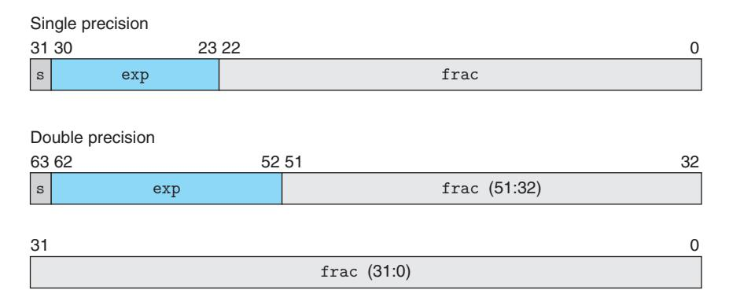

# 2.4 Floating Point

A floating-point representation encodes rational numbers of the form *V* = *x* × 2*y*. It is useful for performing computations involving very large numbers (|*V* | 0),

## 2.4.1 Fractional Binary Number

Decimal notation
$$d_m d_{m-1} \cdots d_1 d_0 \cdot d_{-1} d_{-2} \cdots d_{-n}$$
where each decimal digit  $d_i$  ranges between 0 and 9. This notation represents a value d defined as
$$d = \sum_{i=-n}^{m} 10^i \times d_i$$
The weighting of the digits is defined relative to the decimal point symbol ('.'), meaning that digits to the left are weighted by nonnegative powers of 10, giving integral values, while digits to the right are weighted by negative powers of 10, giving fractional values. For example,  $12.34_{10}$  represents the number  $1 \times 10^1 + 2 \times 10^0 + 3 \times 10^{-1} + 4 \times 10^{-2} = 12\frac{34}{100}$ .

Binary Notation
$$b_m b_{m-1} \cdots b_1 b_0 \cdot b_{-1} b_{-2} \cdots b_{-n+1} b_{-n}$$
$$b = \sum_{i=-n}^{m} 2^i \times b_i \tag{2.19}$$
The symbol '.' now becomes a *binary point*, with bits on the left being weighted by nonnegative powers of 2, and those on the right being weighted by negative powers of 2. For example,  $101.11_2$  represents the number  $1 \times 2^2 + 0 \times 2^1 + 1 \times 2^0 + 1 \times 2^{-1} + 1 \times 2^{-2} = 4 + 0 + 1 + \frac{1}{2} + \frac{1}{4} = 5\frac{3}{4}$ .

- **Practice Problem 2.46**

The imprecision of floating-point arithmetic can have disastrous effects. On February 25, 1991, during the first Gulf War, an American Patriot Missile battery in Dharan, Saudi Arabia, failed to intercept an incoming Iraqi Scud missile. The Scud struck an American Army barracks and killed 28 soldiers. The US General

Accounting Office (GAO) conducted a detailed analysis of the failure [76] and determined that the underlying cause was an imprecision in a numeric calculation. In this exercise, you will reproduce part of the GAO's analysis.

The Patriot system contains an internal clock, implemented as a counter that is incremented every 0.1 seconds. To determine the time in seconds, the program would multiply the value of this counter by a 24-bit quantity that was a fractional binary approximation to  $\frac{1}{10}$ . In particular, the binary representation of  $\frac{1}{10}$  is the nonterminating sequence 0.000110011[0011]  $\cdots$ 2, where the portion in brackets is repeated indefinitely. The program approximated 0.1, as a value x, by considering just the first 23 bits of the sequence to the right of the binary point: x = 0.000110011001100110011001100. (See Problem 2.51 for a discussion of how they could have approximated 0.1 more precisely.)

- A. What is the binary representation of 0.1 x?
- B. What is the approximate decimal value of 0.1 x?
- C. The clock starts at 0 when the system is first powered up and keeps counting up from there. In this case, the system had been running for around 100 hours. What was the difference between the actual time and the time computed by the software?
- D. The system predicts where an incoming missile will appear based on its velocity and the time of the last radar detection. Given that a Scud travels at around 2,000 meters per second, how far off was its prediction?

Normally, a slight error in the absolute time reported by a clock reading would not affect a tracking computation. Instead, it should depend on the relative time between two successive readings. The problem was that the Patriot software had been upgraded to use a more accurate function for reading time, but not all of the function calls had been replaced by the new code. As a result, the tracking software used the accurate time for one reading and the inaccurate time for the other.
Solution:
A. \[\boxed{0.1-x=0.000000000000000000000001100110011\ldots_2}\]
B. \[\boxed{0.1-x=0.000000095367431640625}\] or \[\boxed{9.5367431640625\times10^{-8}}\]
C. \[\boxed{E=0.34332275390625\text{ seconds}}\]
D. \[\boxed{D\approx686.65\text{ meters}}\]

## 2.4.2 IEEE Floating-Point Representation

The IEEE floating-point standard represents a number in a form  $V = (-1)^s \times M \times 2^E$ :

- The sign s determines whether the number is negative (s = 1) or positive (s = 0), where the interpretation of the sign bit for numeric value 0 is handled as a special case.
- The *significand M* is a fractional binary number that ranges either between 1 and  $2 \epsilon$  or between 0 and  $1 \epsilon$ .
- The *exponent E* weights the value by a (possibly negative) power of 2.

The bit representation of a floating-point number is divided into three fields to encode these values:

- The single sign bit s directly encodes the sign s.
- The *k*-bit exponent field  $\exp = e_{k-1} \cdots e_1 e_0$  encodes the exponent *E*.
- The *n*-bit fraction field  $frac = f_{n-1} \cdots f_1 f_0$  encodes the significand M, but the value encoded also depends on whether or not the exponent field equals 0.

Figure shows the packing of these three fields into words for the two most common formats. In the single-precision floating-point format (a float in C), fields s, exp, and frac are 1, k = 8, and n = 23 bits each, yielding a 32-bit representation. In the double-precision floating-point format (a double in C), fields s, exp, and frac are 1, k = 11, and n = 52 bits each, yielding a 64-bit representation.

The value encoded by a given bit representation can be divided into three different cases (the latter having two variants), depending on the value of exp. These are illustrated in Figure 2.33 for the single-precision format.

### Case 1: Normalized Values

This is the most common case. It occurs when the bit pattern of exp is neither all zeros (numeric value 0) nor all ones (numeric value 255 for single precision, 2047 for double). In this case, the exponent field is interpreted as representing a signed integer in *biased* form. That is, the exponent value is E = e - Bias, where e is the unsigned number having bit representation  $e_{k-1} \cdots e_1 e_0$  and Bias is a bias value equal to  $2^{k-1} - 1$  (127 for single precision and 1023 for double). This yields exponent ranges from -126 to +127 for single precision and -1022 to +1023 for double precision.

The fraction field frac is interpreted as representing the fractional value f, where  $0 \le f < 1$ , having binary representation  $0.f_{n-1} \cdots f_1 f_0$ , that is, with the 
binary point to the left of the most significant bit. The significand is defined to be *M* = 1 + *f* . This is sometimes called an *implied leading 1* representation, because we can view *M* to be the number with binary representation 1*.fn*−1*fn*−2 *... f*0. This representation is a trick for getting an additional bit of precision for free, since we can always adjust the exponent *E* so that significand *M* is in the range 1 ≤ *M <* 2 (assuming there is no overflow). We therefore do not need to explicitly represent the leading bit, since it always equals 1.

### Case 2: Denormalized Values

When the exponent field is all zeros, the represented number is in *denormalized* form. In this case, the exponent value is *E* = 1 − *Bias*, and the significand value is *M* = *f* , that is, the value of the fraction field without an implied leading 1.

Denormalized numbers serve two purposes. First, they provide a way to represent numeric value 0, since with a normalized number we must always have *M* ≥ 1, and hence we cannot represent 0. In fact, the floating-point representation of +0*.*0 has a bit pattern of all zeros: the sign bit is 0, the exponent field is all zeros (indicating a denormalized value), and the fraction field is all zeros, giving *M* = *f* = 0. Curiously, when the sign bit is 1, but the other fields are all zeros, we get the value −0*.*0. With IEEE floating-point format, the values −0*.*0 and +0*.*0 are considered different in some ways and the same in others.

A second function of denormalized numbers is to represent numbers that are very close to 0.0. They provide a property known as *gradual underflow* in which possible numeric values are spaced evenly near 0.0.

### Case 3: Special Values

A final category of values occurs when the exponent field is all ones. When the fraction field is all zeros, the resulting values represent infinity, either  $+\infty$  when s=0 or  $-\infty$  when s=1. Infinity can represent results that *overflow*, as when we multiply two very large numbers, or when we divide by zero. When the fraction field is nonzero, the resulting value is called a NaN, short for "not a number." Such values are returned as the result of an operation where the result cannot be given as a real number or as infinity, as when computing  $\sqrt{-1}$  or  $\infty - \infty$ . They can also be useful in some applications for representing uninitialized data.

## 2.4.3 Example Numbers

